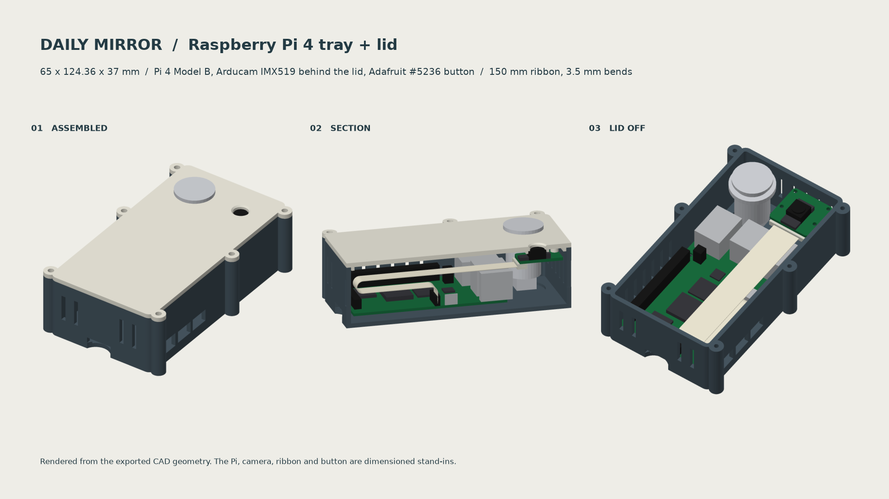

# Daily Mirror — Raspberry Pi 4 tray and lid

A closed version of the `../enclosure-p4-open` tray for the **Raspberry Pi 4
Model B**: the same 2.5 mm walls, 4 mm corners and screw ears, but with a full
lid. The **Arducam IMX519** hangs under the lid with its lens in a bore, and an
**Adafruit #5236** (19 mm metal button with a NeoPixel ring) sits next to it.

Outer size: **65 x 124.4 x 37 mm** (76.6 mm wide across the lid screw ears).
Inside: 60 x 119.4 x 32 mm. The 37 mm depth is set by the button, which needs
33 mm behind the lid face.

Rebuild with `./build.sh` (FreeCAD 1.1: build, verify, renders). Slice with
`./slice.sh` (Bambu A1, bed 55 C; it does not send anything to the printer).
Unlike the sibling folders, `output/` is committed here: STL, STEP, 3MF, renders
and the check reports.

More views: [exterior](output/exterior.png), [cutaway](output/cutaway.png),
[exploded](output/exploded.png), [lid off](output/lid-off.png).

## Layout

- Axes as in enclosure-p4-open: X across, Y along (microSD end at Y=0, camera
  end at Y=124.4), Z out from the flat back (Z=0). Hung on the wall, Y is up.
- The Pi stands **portrait, USB/Ethernet end up, components toward the lid**, on
  four 4 mm posts. Seen from the front, the USB-C/HDMI edge is on the right and
  the GPIO header on the left. The board drops straight in: 3 mm to the right
  wall (the audio jack sticks out 2.6), 1 mm on the left, 1.5 mm at the bottom.
- Above the Pi is a 27 mm bay with nothing on the floor. The camera and the
  button hang from the lid there, side by side at Y=105.75.
- **The lens is 15.5 mm right of centre** (X=48). The ribbon leaves the Pi's CSI
  socket 11.5 mm from the board edge and cannot shift sideways without a
  crease, so the camera sits on that line. The button is at X=18.5.
- The back is a flat 65 x 124.4 face. The only marks on it are a 16 mm finger
  scoop at the microSD end. **Rail mounting is not included yet.**

## Camera mount

- Four 5.3 mm posts on the lid's inside face, 21 x 12.5 mm pattern, 1.6 mm
  pilots. The camera screws on from behind with its lens side against the
  posts, so the board is parallel to the lid.
- The 7.5 mm lens barrel stands in an 8.5 mm bore (0.5 mm all round, for
  autofocus travel) and stops 1.8 mm below the lid face. The bore has a 0.8 mm
  chamfer outside so it does not clip the corners of the picture.
- A square collar under the lid wraps the top 1.2 mm of the 9.5 mm lens block
  with 0.4 mm clearance. Light from the Pi's LEDs has to pass that and the bore
  gap to reach the front.
- The connector edge points down at the Pi, so the picture is upright.

## Ribbon

The stock **150 mm** 15-pin ribbon is used as is. It rises from the CSI socket,
turns back toward the microSD end 11 mm above the board, makes a U-turn 3.3 mm
from the bottom wall, and runs straight back over the USB stack (1.9 mm above
it) into the camera connector. All three bends are **3.5 mm radius**, and the
ribbon stays flat across its width the whole way. See the cutaway render.

`fpc_length` in `dimensions.json` sets how far the fold-back goes. Lengths from
67.5 to 154.5 mm fit; a 100 mm ribbon folds back only 20 mm. Nothing printed
depends on the length.

## Openings

| Opening | Where | Size |
| --- | --- | --- |
| USB-C power | right wall, 15.2 mm from the bottom | 13.5 x 8 mm, for plugs up to 13 x 7 mm |
| micro-HDMI 0 and 1 | right wall, 30 and 43.5 mm from the bottom | 11.5 x 7 mm each, slim plugs only (11 x 6.5) |
| microSD | bottom wall, with a finger scoop in the back edge | 15 mm slot; the card ends 1 mm inside it |
| Vents | 6 slits in the left wall, 7 in the top wall, 4 in the bottom wall | 2.5 x 15 mm |
| Lens | lid | 8.5 mm bore |
| Button | lid | 19.4 mm |

- The power plug enters from the right side, 15 mm above the bottom, and sticks
  out about 30 mm. Use a right-angle plug if the cable should run down the wall.
- **USB-A, Ethernet and the audio jack have no openings.** The USB/Ethernet end
  faces the camera bay, not a wall, and this is a Wi-Fi device. A USB stick or
  short adapter still fits inside the bay.
- Set `hdmi_windows` to `false` for a closed wall.
- The top and bottom vents make a chimney when the housing hangs on the wall.

## Button

Adafruit #5236 is the "ChromaTek 19 mm rugged momentary pushbutton with
NeoPixel": M19 x 1 thread, 21.8 mm bezel, 25 mm nut, 33 mm from the back of the
bezel to the blade tips. The tips end 4 mm above the back. The floor is thinned
to 1 mm in a 24 mm circle behind them, which leaves **3 mm** for the wires.
The plug-on harness will not fit in that; solder to the blades and lead the
wires sideways, or bend the blades over.

## Raspberry Pi 5

The Pi 5 has the same outline, mounting holes and USB-C position, so it screws
onto the same posts and takes power through the same window. I did not model it,
and the Lid needs changes before it can be used:

| Item | Pi 5 | Effect |
| --- | --- | --- |
| micro-HDMI | 0.2 and 0.3 mm closer to USB-C | Fits the same windows, with 0.05 mm less margin on one side |
| Camera sockets | two 22-pin, about 2.3 and 8.5 mm further up, 3 mm closer to the board edge | Needs a 22-to-15 ribbon, and the camera posts, bore and collar move about 3 mm right. Change `CSI` in `build.py` |
| USB and Ethernet | swapped | None; both are enclosed |
| Power button | on the microSD edge | Not reachable |
| Audio jack | none | None |
| Active cooler | about 10 mm tall | Fits; there is 26.5 mm above the board |

## Parameters to measure

All in `dimensions.json`. Pi positions come from the official mechanical
drawing; the ones below are scaled from it or assumed.

| Key | Now | What it is |
| --- | --- | --- |
| `pi_pcb_thickness` | 1.5 | Not on the drawing; 1.4 to 1.6 |
| `pi_underside_allowance` | 2.5 | Pin tails and the microSD socket under the board (posts are 4) |
| `pi_port_side_gap` | 3.0 | Must exceed the audio jack overhang (2.6, scaled) |
| `usbc_window_width`, `usbc_window_height` | 13.5, 8 | Your plug's overmold plus 0.5 |
| `hdmi_window_width`, `hdmi_window_height` | 11.5, 7 | Same, for micro-HDMI |
| `camera_lens_from_connector_edge` | 9.75 | From Arducam's STEP; the Pi Camera v2 is 9.46 |
| `camera_lens_block_height` | 5.0 | Sets the post height (block + 0.3) |
| `camera_connector_slot_below_pcb` | 1.5 | Where the ribbon enters the camera connector; sets the ribbon height |
| `fpc_length` | 150 | Your ribbon |
| `button_hole` | 19.4 | Measure the thread's outer diameter |
| `button_length_behind_panel` | 33 | Datasheet; a gasket under the bezel adds room |
| `button_nut_diameter` | 25 | Across corners; must clear the lid lip (0.6 mm now) |

Two things I could not confirm from documents and that the layout depends on:

- **Ribbon contact sides.** The route assumes the contacts face the HDMI ports
  at the Pi and face the camera's PCB at the camera, as on the Pi Camera v2.
  Arducam's documents disagree with each other on the camera end. If the
  camera's contacts face away from its PCB, this route does not work.
- **microSD slot position** along the board edge (28 mm from the USB-C edge)
  and the card overhang (2.5 mm). The slot is 15 mm wide for an 11 mm card.

## Print order (Bambu A1, PLA, 0.2 mm, 4 walls, 20% infill, bed 55 C)

| File | Orientation as exported | Time |
| --- | --- | --- |
| `PiFitCoupon` | back on bed | ~30 min, 16 g. Bottom 15 mm of the Tray: Pi posts, USB-C and HDMI windows, microSD slot. Print it **first** |
| `LidFitCoupon` | outer face on bed | ~12 min, 6 g. Camera end of the Lid: posts, bore, collar, button hole |
| `Tray` | back on bed | ~1.7 h, 59 g |
| `Lid` | outer face on bed, posts up | ~30 min, 21 g |

`output/TrayAndLid.gcode.3mf` is the Tray and Lid sliced on one plate (2.3 h,
81 g). `output/TrayAndLid.3mf` is the same pair as a plain model file.

No supports are needed. The port windows bridge up to 13.5 mm, the wall over
the microSD slot bridges 16 mm, and the vents bridge 2.5 mm. The lid prints
with its front face on the plate, so the front takes the plate's texture.

## Screws and parts

| Part | Qty | Use |
| --- | --- | --- |
| M2.5 x 6 thread-forming | 4 | Pi to tray posts (`pi_pilot` 2.1, 5.5 deep) |
| M2 x 6 thread-forming | 4 | Camera to lid posts (`camera_pilot` 1.6) |
| M3 x 10 thread-forming | 6 | Lid to tray ears (`case_pilot` 2.5; 3.4 clearance in the lid) |
| 15-pin 1.0 mm camera ribbon, 150 mm | 1 | The one supplied with the camera |

For M2.5 heat-set inserts in the Pi posts, set `pi_pilot` to the insert's hole
(about 3.4) and `pi_post_diameter` to 7. I have not checked that a 7 mm post
clears the parts under the board.

## Files

- `output/Tray.step|stl`, `output/Lid.step|stl`, `output/PiFitCoupon.step|stl`, `output/LidFitCoupon.step|stl`
- `output/TrayAndLid.3mf`, `output/TrayAndLid.gcode.3mf`, `output/Assembly.step`
- `output/enclosure-preview.png`, `exterior.png`, `cutaway.png`, `exploded.png`, `lid-off.png`
- `output/verify.json` (68 fit checks), `output/validation.json`, `output/layout.json`, `output/manifest.json`
- `output/DailyMirror-Pi4.FCStd` is rebuilt by `./build.sh` and not committed.

The Pi, camera, ribbon and button in the renders and checks are stand-ins I
modelled from the drawings, not vendor STEP files. Nothing has been printed or
test-fitted.
